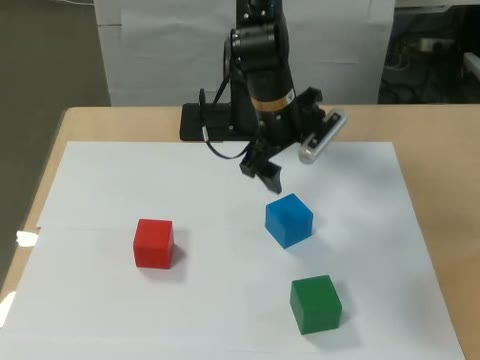
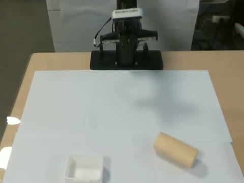
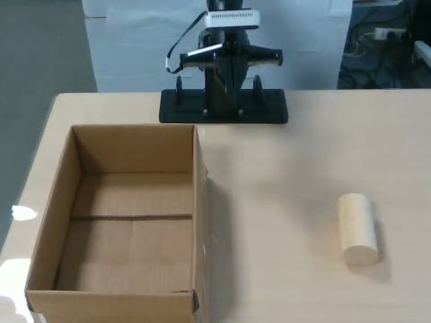

# PARIS: Real-Robot Rollouts

Nine illustrative clips from the single-arm robot recordings. The IDs follow the real-robot figure in the paper. View labels describe the recording camera.

## View the results

Open [index.html](index.html) from a local checkout or visit the GitHub Pages site if enabled. Select a frame below to open the corresponding animated GIF.

## Source Domain

| S1 · Block stacking | S2 · Sphere placement | S3 · Cylinder placement |
| :---: | :---: | :---: |
|  |  |  |

- **S1** White mat with a red distractor.
- **S2** Sphere transfer from a small tray into a box on the bare tabletop.
- **S3** The cylinder ends upright in the shallow holder.

## Target Domain

### Changes to the physical setup

| U1 · Block stacking | U2 · Sphere placement | U3 · Cylinder placement |
| :---: | :---: | :---: |
|  |  |  |

- **U1** Bare tabletop with a yellow distractor and a different block arrangement.
- **U2** The same tray-to-box transfer takes place on a white mat.
- **U3** The cylinder ends on its side inside a deeper cardboard box.

### Top-down recordings

| U4 · Block stacking | U5 · Sphere placement | U6 · Cylinder placement |
| :---: | :---: | :---: |
|  |  |  |

- **U4** The blue block is stacked on the green block in the overhead view.
- **U5** The source tray and destination box are visible from above.
- **U6** The cylinder is transferred into the cardboard box in the overhead view.

## Host on GitHub Pages

Place these files at the repository root or in <code>docs/</code>. In the repository Pages settings, select the branch and the matching directory as the publishing source. All assets use relative links and the site requires no build step. For anonymous review through a repository mirror, share the anonymous repository link. The preview table above can be used without deploying a Pages site.

[GitHub Pages publishing source instructions](https://docs.github.com/en/pages/getting-started-with-github-pages/configuring-a-publishing-source-for-your-github-pages-site)
